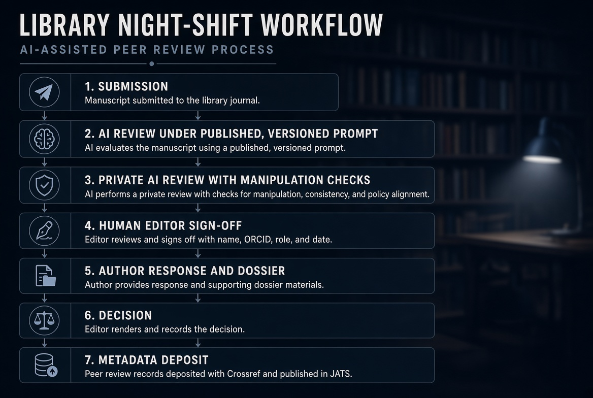

```{r setup, include=FALSE}
knitr::opts_chunk$set(echo = FALSE)
```

## // ... stack log

> *Night shift in the stacks. The coffee is synthetic, the reading-room lamps hum, and somewhere in Cambridge, Massachusetts, a machine just out-reviewed the carbon reviewers. Not the overworked colleague writing report number six at 2 a.m. The good ones: Paid, hand-picked, constructive.*  
*The run was logged before the neon lamps warmed. The shelves are still standing. The question was never whether the machine shows up. It was always who signs the record. Badge in, check your metadata, and follow the log into the reading room.*

## // The paper

**Source.** Gary King and Steven Worthington. *AI Article Reviews Dominate Human Peer Reviews at Their Best: Evidence and Policy Choices*. Working paper, Institute for Quantitative Social Science (IQSS), Harvard University, 28 October 2026. <https://gking.harvard.edu/peerless/> ([PDF](https://gking.harvard.edu/files/peerless.pdf), [Supplementary Appendix](https://gking.harvard.edu/files/peerless-supp.pdf)). Authors: Gary King ([ORCID 0000-0002-5327-7631](https://orcid.org/0000-0002-5327-7631)), Steven Worthington ([ORCID 0000-0001-9550-5797](https://orcid.org/0000-0001-9550-5797)).\
**PID status.** The paper has no DOI, and we found no arXiv or SSRN record. A title search in Crossref on 13 November returned a commentary by Stephen Turner that carries a DOI, two in fact ([10.59350/1zd90-fy786](https://doi.org/10.59350/1zd90-fy786) and [10.59350/006kh-wdm07](https://doi.org/10.59350/006kh-wdm07), same post), but nothing for the paper itself. You can repeat the check with our [DOI lookup tool](https://www.datamercs.net/tools/doi-check/doi-check.html). Accessed 13 November 2026.

*Peer review* is the immune system of science, and it is running a fever:

Submissions are up, reviewers are scarce, reports arrive late, and nobody can say with a straight face that two reviewers of the same paper usually agree.

Into this walks a working paper from Harvard with a title that does not hedge:

**AI reviews "dominate" human reviews "at their best".**

We think it may mark the start of a real paradigm shift in how expensive, largely publicly funded peer review is done. We also think it will be misread in both directions, by people who want to replace reviewers tomorrow and by people who want to ban the machines forever.

So here is what it shows, what it does not, and what a library publisher or university press can do about it on Monday.

## // The short version

- **The layer.** This is a study of *developmental* review: Reports that help authors improve a draft before journal submission. The authors say so plainly: Their results speak to helping authors, not to how editors should decide what to publish.

- **The finding.** On 124 papers, a frontier model's review beat a paid, carefully chosen human expert's review almost every time, according to an AI judge from a different model family and, in a small blind test, three former journal editors.

- **The catch.** The main judge is an AI, the human check is small, the authors run the service the human reviews came from, and the paper is an *unreviewed working paper* with no persistent identifier. Rather thin on the signature line.

- **The opportunity.** If AI reviews are this good at the developmental layer, the bottleneck moves to accountability: Who signs, what was run, under which prompt, and where that is recorded.

  That is a metadata job, and libraries are good at metadata.

## // What they actually did

Layer first. The human reviews come from [**rapidPeer**](https://rapidpeer.iq.harvard.edu), a service developed at Harvard's [IQSS](https://www.iq.harvard.edu) (and since expanded to other institutions) that gives faculty double-blind reviews of their drafts *before* journal submission.

Reviewers come from other institutions, are chosen by experts in the field, are paid "(well)", asked to read the whole paper, write at least 1.5 to 2 pages, and be constructive rather than hunt for a fatal flaw on page 3. Authors loved them: 88% of 74 survey respondents rated their review high or very high quality, and the median author would recommend the service at 10 out of 10.

These are not tired volunteers. They are about as good as human reviewing gets.

The corpus is every eligible *rapidPeer* submission: **124 papers and 134 human reviews** (10 papers had two reviewers), from 2019 to 2026, across statistical, formal and qualitative social science.

For each paper the authors generated one review with **Claude Opus 4.8** at its maximum reasoning setting, under two conditions:

- **Matched:** The anonymised manuscript plus the verbatim rapidPeer reviewer guidelines, no external tools.
- **Tuned:** A purpose-built prompt (written before any judging and never tuned against the judges) plus web retrieval. Every tuned review searched the web, 12.4 times on average.

The judge was **GPT-5.5**, deliberately from a different model family, with every comparison run in both presentation orders and a win counted only when the same review won both times. Three former editors of leading journals then judged 10 randomly chosen, blinded pairs without knowing that one review in each pair was machine-written.

## // What the numbers say

All figures below were checked against the PDF.

- **Overall:** The AI review won every decided pair. Judged from the reviews alone, that is 134 of 134 pairs for the matched condition and 132 of 132 decided pairs for the tuned one (two pairs flipped with presentation order and count as undecided). With the manuscript in hand and told to check claims against it, the judge still never preferred a human review in both orders.
- **Human editors:** The three former editors preferred the AI review in **26 of 30 judgments (87%)**, individually 8, 8 and 10 out of 10. They agreed with each other 80% of the time and with the AI judge 87% of the time. They were not asked to read the manuscripts.
- **By review area:** In the tuned condition the AI won 92% to 100% of decided pairs across theory, methods, weaknesses, framing, communication, figures and sources. Without web access it won only 62% on sources, which tells you something about what reviewers do with a browser.
- **Citations:** The tuned AI cited **651 sources with a DOI or arXiv identifier**. 648 matched a real record in Crossref, doi.org or arXiv automatically, and the remaining three were confirmed by hand: **zero fabricated**. 301 of 320 cited URLs resolved. In a sample of 20 reviews, 99 of 100 decidable citations were on topic, and 23 of 24 specific attributions were supported by the cited abstract. This is exactly the kind of check anyone can run: Paste a DOI into our [DOI lookup tool](https://www.datamercs.net/tools/doi-check/doi-check.html) and see whether Crossref knows it.
- **Claims:** Checked against the manuscript by a blinded AI judge, **5.5% of AI claim assessments (57 of 1,039)** were contradicted by the paper, against **15.9% (152 of 956)** for the human reviews. A human spot check of 90 claims agreed with the audit in 87 cases. Still, 37.1% of AI reviews contained at least one flagged error (64.2% of human reviews). Better is not the same as flawless.
- **Robustness:** The authors ran **fourteen** checks: Length-matched pairs, coverage, the strongest human reviews, restyling the human reviews in AI register, training-data contamination by submission year, a replication with other models and judges, subgroups by method, novelty, rank and career length, and more. None changed the conclusion.

## // Read the fine print

The paper is careful about its limits. We list the ones that matter for anyone tempted to quote the headline.

1.  **Conflict of interest, declared.** The authors conceived of and run rapidPeer, and say so in the ethics statement, adding that *their results go against their own interests*.
2.  **The main judge is an AI.** The authors test for AI preferring AI (restyling the human reviews did not help them) and for fluent but shallow reviews (claim checks against the manuscript). The only human check is three editors on ten pairs, without the manuscripts. The authors themselves call for a larger panel.
3.  **Developmental review, not editorial decisions.** The data say AI reviews help authors more. They say nothing about acceptance, rejection or what a field should read. The authors leave that firmly with editors.
4.  **One discipline cluster, one elite setting.** Social science papers from top research universities. The authors expect the result to travel and ask for data to prove it.
5.  **No peer review, no PID.** It is an *unreviewed working paper*. A blog commentary on it has a DOI; the paper does not. See Stephen Turner, “[AI Reviews Might Beat Human Peer Reviews](https://blog.stephenturner.us/p/ai-peer-reviews-beat-humans)” (Paired Ends, 24 October 2026; DOIs [10.59350/1zd90-fy786](https://doi.org/10.59350/1zd90-fy786) and [10.59350/006kh-wdm07](https://doi.org/10.59350/006kh-wdm07)).

And the paper names its own risks, which deserve quoting rather than paraphrasing: AI brainstorming pulls everyone "toward the conventional, orthodox, and majoritarian", AI reviews "may also have some of the same issues", and a small number of models "may take the whole literature closer to a single point of failure, controlled by a few technology companies". Publish the prompt, and authors will revise until the AI is happy, possibly "in ways the AI rewards that have nothing to do with the quality of the science".

## // Five policies, one layer each

The second half of the paper sketches five journal policies. Each works on a different layer, so it helps to name it before arguing about it.

| Policy (King and Worthington) | Intended layer | Operational supplement we would add |
|------------------------|------------------------|------------------------|
| 1\. Recommend or require that authors iterate with AI before submission | Author preparation | Ask authors to disclose model, version and date in the cover letter, so editors know which machine already had a go. |
| 2\. Publish an official journal AI prompt for authors | Editorial standards, made machine-readable | Give the prompt a version number and a persistent URL or DOI, and archive old versions. A prompt that changes silently is a moving goalpost. |
| 3\. Require an AI review under that prompt, plus an author letter answering it | Submission package | Store the AI review and the author letter as structured objects in the submission system, not as PDF attachments. |
| 4\. Replace human review entirely | Review process | The authors themselves warn that authors will simply pre-run the public review. If anyone tries this, keep a second, undisclosed prompt and log every run. |
| 5\. The editor reviews a dossier (paper, AI review, author response), adds a private AI review with manipulation checks, and calls in board members or outside reviewers for hard cases | Editorial decision | Record who signed off, on what, and when, in the review metadata. This is the one we would pilot. |

Policy 5 is, in effect, a workflow a university press could run. More on that below.

## // Our take: Public money, open receipts

*Here we leave the paper and speak for ourselves.*

Peer review runs on donated time - and more of those unpaid packages have been carried than anyone cares to count. Most reviewers are researchers whose salaries come from universities and research funders, which means largely from taxes, and an estimate of what that time is worth carries the apt title ["A billion-dollar donation"](https://doi.org/10.1186/s41073-021-00118-2).

Publishers then sell or license the result, and libraries pay again for access or for open-access fees, a loop we described in ["Paying twice for prestige"](https://www.datamercs.net/posts/2026-10-20-paying-twice-for-prestige/).

The problems *King* and *Worthington* list in their introduction are well documented and structural:

☛ Low agreement between reviewers,

☛ bias by author characteristics and topic,

☛ "opacity and little accountability",

☛ delays and recruitment trouble.

That is not a verdict on the people doing the work, most of whom are overloaded and unpaid. It is a verdict on a system that gives small, closed circles a lot of quiet power and very little documentation.

If a model can write a better developmental review in minutes, the case for spending scarce expert time on first-round, author-improvement reviews gets weak. That time is better spent where judgement is irreplaceable: Is this important, is it right for this journal, should the field read it?

And on objectivity, the paper makes a point we like: An AI's biases toward certain questions or styles are real, "but the process would be easier to study and adjust than with human reviewers": A prompt can be published, versioned and audited. A reviewer's mood cannot.

The flip side is just as real: machine review is not free, it concentrates power in a handful of model providers, and it can homogenise what gets written. The answer is not to refuse it. The answer is to keep the receipts in the open: a published prompt, a named human, and the whole chain written into the metadata.  
A reviewer’s mood cannot be versioned. A prompt can.

## // The big players

Is anyone of the usual suspects possibly building a dedicated AI review tool, already?

Indeed, though mostly as an assistant for reviewers and editors rather than a review writer. What we could source, as of 13 November 2026:

- **Springer Nature and Google DeepMind.** On 26 October 2026 they announced a research partnership to "co-design an AI peer review assistant". A prototype is "currently being tested", built on Google's Agent Development Kit and running "solely in Springer Nature's private, secure Gemini Enterprise platform". No journals, rollout date or results have been named ([Springer Nature press release](https://group.springernature.com/gp/group/media/press-releases/research-partnership-with-googledeepmind-to-support-peer-review/53891572); our [2 November notes](https://www.datamercs.net/posts/2026-11-02-industry-notes-dates-versions-and-one-preference-line/)).
- **Frontiers, AIRA.** An in-house "Artificial Intelligence Review Assistant" launched in 2018, now a family of tools running over 40 quality and integrity checks per submission, plus "AIRA Review Guide", an optional chat assistant for reviewers inside the review forum. Decisions stay with humans ([Frontiers on AI](https://www.frontiersin.org/about/artificial-intelligence)).
- **Hum, Alchemist Review, with Purpose-Led Publishing.** An editor-facing manuscript assessment tool with citation validation by Grounded AI, developed with AIP Publishing, IOP Publishing and the American Physical Society, with Oxford University Press as an early adopter ([ALPSP, 5 Sept 2025](https://www.alpsp.org/news-publications/alpsp-blog/spotlight-on-alchemist-review/)). In June 2026 AIP Publishing brought it to AIP Conference Proceedings as a quality-control layer ([AIP Publishing, 11 June 2026](https://publishing.aip.org/about/news/aip-publishing-partners-with-hum-to-strengthen-quality-control-for-aip-conference-proceedings/)).
- **Enago, PeerAI.** A commercial product with three parts: Editor Consult for triage, a Reviewer Assistant, and an "AI-generated peer review report" offered "as an additional source of review input for editors". The closest thing on the market to the King and Worthington setup. The product page names no customers ([Enago PeerAI](https://www.enago.com/publishers/peer-ai)).
- **ScholarOne (Silverchair), Editor AI Console.** Launched on 21 July 2026 as an optional extension: Journal-specific summaries of methods, ethics and readiness, with editors able to "view, customize, and refine" the prompts. A visible, editable prompt is a small step toward policy 2 ([Silverchair, 21 July 2026](https://www.silverchair.com/news/silverchair-advances-editor-experience/)).
- **Screening, not reviewing.** Integra's EditorialPilot runs over 100 configurable submission checks inside Editorial Manager and ScholarOne ([Aries Systems](https://www.ariessys.com/news-and-events/press-releases/aries-systems-partners-with-integra-to-bring-ai-driven-quality-and-integrity-checks-to-the-editorial-workflow/)). Wiley's Research Exchange uses AI for reviewer matching, scope and integrity checks ([Wiley](https://www.wiley.com/en-us/about-us/ai/role-of-artificial-intelligence-in-research-exchange)). Elsevier's editors get in-system AI for finding reviewers, scope matching and duplicate detection, while its policy (updated June 2026) tells reviewers and editors not to upload manuscripts to AI tools ([Elsevier](https://www.elsevier.com/about/policies-and-standards/generative-ai-policies-for-journals)). That rule's intended layer is confidentiality and individual accountability, and it does that job. The supplement we would ask for is a public list of which in-system tools touch a manuscript, so authors know what the publisher runs while reviewers may not.
- **Outside publishing houses.** The AAAI-26 conference added one clearly labelled AI review to each of the 22,977 papers sent for full review, alongside the human ones ([Biswas et al., arXiv:2604.13940](https://arxiv.org/abs/2604.13940)).

## // For library publishers and university presses

Libraries already run journal platforms, advise on funding and open access, and in many places host a university press.

That is exactly the position from which to do this properly: Use AI review where it helps, put the press's own name on the process, and record the provenance where machines and people can find it.

### A workflow sketch



1.  **Submission.** The author submits the paper and, if the journal asks for it, the AI review they already ran under the published prompt.
2.  **AI review under the published prompt.** The press runs its official prompt, with model, version, date and parameters logged.
3.  **Second AI review.** A private prompt with manipulation checks, as the paper suggests, so that gaming the public prompt does not pay.
4.  **Human editor sign-off.** A named editor reads the AI output, strikes what is wrong, adds what is missing, and signs. Hard cases go to a board member or an outside reviewer.
5.  **Author response and dossier.** Paper, AI review, editor notes, author response, in one package.
6.  **Decision and metadata deposit.** The decision is human. The review record, including AI provenance, is deposited with the article.

### What to record

Two standards already cover most of the review record. Neither has a field for AI, so the AI provenance needs a convention until NISO, Crossref or JATS4R give it a home.

**Crossref peer review records** (schema 5.4.0, deposited as XML only, and the reviewed item must itself have a Crossref DOI; see [Crossref’s peer review documentation](https://www.crossref.org/documentation/research-nexus/peer-reviews/), the [peer-review markup guide](https://www.crossref.org/documentation/schema-library/markup-guide-record-types/peer-reviews/), and the [schema](https://gitlab.com/crossref/schema)):

- `peer_review` attributes: `stage` (pre-publication or post-publication), `type` (referee-report, editor-report, author-comment, community-comment, manuscript, aggregate, recommendation), `recommendation`, `revision-round` (first submission is 0), `language`.
- Elements: `contributors` (roles include reviewer, review-assistant, stats-reviewer, editor), `titles`, `review_date`, `institution`, `competing_interest_statement`, `running_number`, a licence in `ai:program`, the relation to the reviewed work in `rel:program` (`isReviewOf`, with the article's DOI), and `doi_data`.
- One trap for the unwary: In the Crossref schema, `ai:program` means **Access Indicators**, that is the licence. It has nothing to do with artificial intelligence.

**JATS 1.3 and 1.4**, following the [JATS4R peer review recommendation](https://jats4r.niso.org/peer-review-materials/) (NISO RP-39-2021, [DOI 10.3789/niso-rp-39-2021](https://doi.org/10.3789/niso-rp-39-2021)):

- A `<sub-article article-type="reviewer-report">` (or `editor-report`, `author-comment`) with its own `front-stub`, DOI, contributors with a `role` whose `@specific-use` is reviewer, editor, author or reader, an `event` in `pub-history`, and a `related-object` pointing to the reviewed article.
- A `custom-meta-group` for JATS4R's `peer-review-stage`, `peer-review-revision-round` and `peer-review-recommendation`.
- There is no JATS element for AI provenance. `processing-meta` exists in 1.4, but it describes the XML tag set used, not how the content was produced. So AI fields go into `custom-meta`, under names you document.

**The AI provenance fields** we would record for every AI-assisted report:

| Field | Example value |
|------------------------------------|------------------------------------|
| Model name | Example-Model |
| Model version or snapshot | 2026-10-01 |
| Provider | Example AI Ltd. |
| Hosting | Provider API under enterprise terms, no training on inputs |
| Prompt identifier, URL and version | press-review-prompt v1.2, persistent URL or DOI |
| Date and time run | 2026-11-13T10:42Z |
| Parameters | Reasoning effort, temperature, tools enabled (web search yes or no) |
| Run identifier | Internal log ID |
| Human sign-off | Name, ORCID, role (handling editor), date |
| What the human changed | Accepted as is, edited, or partly rejected |
| Disclosure statement | One plain sentence, published with the report |

**Example only: a Crossref deposit for an AI-assisted report.** Placeholders throughout. Note that the human who signed is the contributor; the model is not.

``` xml
<!-- EXAMPLE ONLY. Crossref schema 5.4.0. Placeholder DOIs, names and URLs. -->
<peer_review stage="pre-publication" type="referee-report"
             recommendation="minor-revision" revision-round="0" language="en">
  <contributors>
    <person_name contributor_role="editor" sequence="first">
      <given_name>Jane</given_name>
      <surname>Smith</surname>
      <ORCID>https://orcid.org/0000-0000-0000-0000</ORCID>
    </person_name>
  </contributors>
  <titles>
    <title>AI-assisted review report, signed by the handling editor: Example article title</title>
  </titles>
  <review_date><month>11</month><day>13</day><year>2026</year></review_date>
  <institution><institution_name>OSDS University Press</institution_name></institution>
  <competing_interest_statement>The signing editor declares no competing interests.
    The press licenses the AI service from Example AI Ltd.</competing_interest_statement>
  <running_number>AI-1</running_number>
  <ai:program name="AccessIndicators">
    <ai:license_ref applies_to="vor">https://creativecommons.org/licenses/by/4.0/</ai:license_ref>
  </ai:program>
  <rel:program>
    <rel:related_item>
      <rel:inter_work_relation relationship-type="isReviewOf"
        identifier-type="doi">10.99999/example.article.1</rel:inter_work_relation>
    </rel:related_item>
  </rel:program>
  <doi_data>
    <doi>10.99999/example.review.1</doi>
    <resource>https://press.example.org/reviews/example-review-1</resource>
  </doi_data>
</peer_review>
```

**Example only: the same report as a JATS sub-article, with AI provenance in `custom-meta`.** The `ai-review-*` names are our proposal, not a standard.

``` xml
<!-- EXAMPLE ONLY. JATS 1.4 with JATS4R peer review tagging. Proposed ai-review-* names. -->
<sub-article article-type="reviewer-report" id="ai-review-1">
  <front-stub>
    <article-id pub-id-type="doi">10.99999/example.review.1</article-id>
    <title-group>
      <article-title>AI-assisted review report: Example article title</article-title>
    </title-group>
    <contrib-group>
      <contrib contrib-type="author">
        <contrib-id contrib-id-type="orcid">https://orcid.org/0000-0000-0000-0000</contrib-id>
        <name><surname>Example</surname><given-names>Jane</given-names></name>
        <role specific-use="editor">Handling editor, reviewed and signed the AI-assisted report</role>
      </contrib>
    </contrib-group>
    <pub-history>
      <event event-type="reviewer-report-received">
        <date iso-8601-date="2026-11-13"><day>13</day><month>11</month><year>2026</year></date>
      </event>
    </pub-history>
    <related-object document-id="10.99999/example.article.1" document-id-type="doi"
                    document-type="peer-reviewed-article"/>
    <custom-meta-group>
      <custom-meta><meta-name>peer-review-stage</meta-name><meta-value>pre-publication</meta-value></custom-meta>
      <custom-meta><meta-name>peer-review-revision-round</meta-name><meta-value>0</meta-value></custom-meta>
      <custom-meta><meta-name>peer-review-recommendation</meta-name><meta-value>minor-revision</meta-value></custom-meta>
      <custom-meta><meta-name>ai-review-model</meta-name><meta-value>Example-Model</meta-value></custom-meta>
      <custom-meta><meta-name>ai-review-model-version</meta-name><meta-value>2026-10-01</meta-value></custom-meta>
      <custom-meta><meta-name>ai-review-provider</meta-name><meta-value>Example AI Ltd.</meta-value></custom-meta>
      <custom-meta><meta-name>ai-review-prompt</meta-name><meta-value>https://press.example.org/prompts/review/v1.2</meta-value></custom-meta>
      <custom-meta><meta-name>ai-review-run-date</meta-name><meta-value>2026-11-13T10:42Z</meta-value></custom-meta>
      <custom-meta><meta-name>ai-review-parameters</meta-name><meta-value>reasoning=max; web-search=on</meta-value></custom-meta>
      <custom-meta><meta-name>ai-review-human-signoff</meta-name><meta-value>https://orcid.org/0000-0000-0000-0000; editor; 2026-11-14</meta-value></custom-meta>
      <custom-meta><meta-name>ai-review-disclosure</meta-name><meta-value>This report was drafted by Example-Model under the press's published review prompt v1.2 and reviewed, edited and signed by the handling editor.</meta-value></custom-meta>
    </custom-meta-group>
  </front-stub>
  <body><p>Review text ...</p></body>
</sub-article>
```

### Questions to ask vendors

1.  Which model, which version and which provider sit behind the tool, and will you tell us when any of them changes?
2.  Where does the manuscript go, which jurisdiction is it processed in, and is anything retained or used for training?
3.  Can we see, version and publish the prompt, or is it a trade secret?
4.  Does the tool write review text, or only flag issues? Can the two be switched separately?
5.  Is every run logged with model, version, prompt version, parameters and timestamp, and can we export that log?
6.  Can the output be exported as JATS and as Crossref peer review metadata, not only as a PDF?
7.  How do you check citations? Against Crossref, doi.org and arXiv directly, or with another model?
8.  What error rates have you measured, on which disciplines and languages, and is the evaluation published?
9.  How do you detect hidden prompts and other manipulation in submitted manuscripts?
10. Can editors and authors see the same AI review, and is that configurable per journal?
11. What happens to our data, prompts and logs when the contract ends?
12. Who is liable when the tool is wrong, and what does the contract say about it?

## // How we can help

If your library, press or consortium wants to try this, we offer consulting on workflow and metadata design, reviews of prompts, vendor contracts and deposit practice, and workshops and training for editorial and metadata staff. [Get in touch](https://www.datamercs.net/contact.html).

## // Verdict

The best human pre-submission reviews just lost to a machine, on the authors' own turf and against their own business interest.

That will not end peer review.

Yet, it should end the pretence that the first, author-improvement round has to be done slowly and for free by people whose time the public already pays for.

Keep the human where judgement is needed, put the machine where it is better, and write both into the record.  
The package gets carried. Someone still signs it.  
A review with no provenance is just another ghost in the stacks.

<p class="news-credit">
Olaf Schmalfuß, with the OSDS AI team · OS DataServices
</p>

<p class="news-credit">
Follow us on X: <a href="https://x.com/DataMercsDotNet">https://x.com/DataMercsDotNet</a>
</p>
